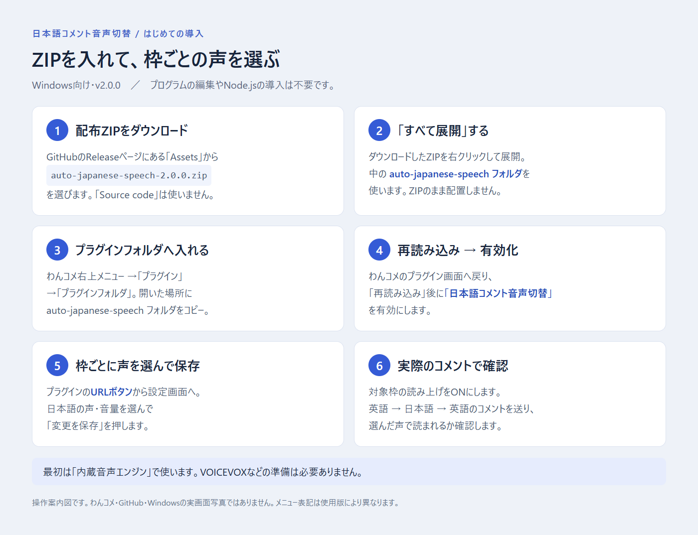
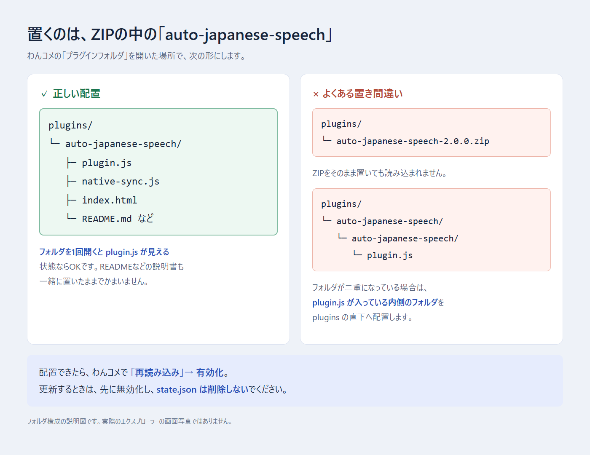
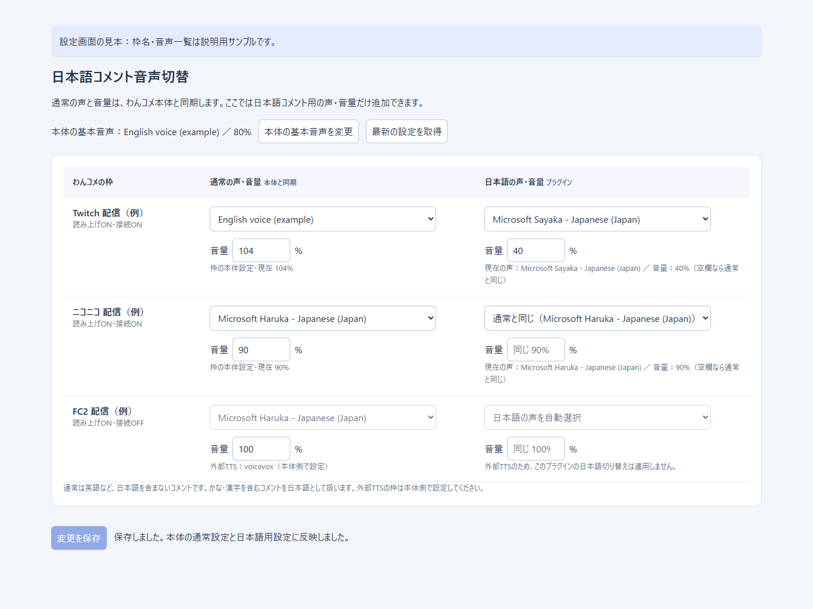

# はじめての導入ガイド

Windows / わんコメ9.2.0-beta.0を対象にしています。プログラム編集・Node.js・APIキー・GitHubアカウントは不要です。

操作案内図です。わんコメやWindowsの画面写真ではありません。

## 1. ダウンロード

[v2.0.0の配布ページ](https://github.com/orangeqoon/onecomme-plugin-auto-japanese-speech/releases/tag/v2.0.0)のAssetsから**auto-japanese-speech-2.0.0.zip**を選びます。[ZIPを直接ダウンロード](https://github.com/orangeqoon/onecomme-plugin-auto-japanese-speech/releases/download/v2.0.0/auto-japanese-speech-2.0.0.zip)。Source codeは開発用です。

## 2. 展開して配置

ZIPを右クリック→「すべて展開」。わんコメの右上メニュー→「プラグイン」→「プラグインフォルダ」を開き、展開した`auto-japanese-speech`フォルダを入れます。フォルダ内に`plugin.js`・`native-sync.js`・`index.html`があることを確認してください。

これは配置の説明図です。ZIPのまま入れたり、同名フォルダを二重にしないでください。

## 3. 有効化

わんコメのプラグイン画面で「再読み込み」→「日本語コメント音声切替」を有効化。プラグインのURLボタンから設定画面を開きます。使用中はわんコメを起動したままにしてください。

## 4. 声と音量を設定

実際の設定画面に架空の枠名・音声一覧を表示した見本です。

- **通常の声・音量〈本体と同期〉**：本体で使っている値が最初から表示されます。変更して保存すると本体へ反映します。英語以外の音声も選べます。
- **日本語の声・音量〈プラグイン〉**：日本語コメントにだけ使う追加設定です。「通常と同じ」で声を共通にできます。「自動選択」では通常が日本語音声ならそれを使い、それ以外はSayaka、利用可能な日本語音声の順に選びます。現在の声も表示します。
- 日本語の音量を空欄にすると通常と同じ。例えば通常80%、日本語40%にすれば日本語を小さめにできます。同じ声でも音量は分けられます。
- **変更を保存**で適用します。通常は0〜200%、日本語は0〜100%の整数です。0は無音。本体のミュートも維持します。

「共通」「サイト」「この枠の設定」を選び直す必要はありません。本体の基本音声を変えたい場合だけ、上の「本体の基本音声を変更」を開きます。枠側に声・音量が指定されている場合は枠の値が優先されます。

枠の一覧・本体の値は5秒ごとに更新します。編集中の入力は残します。本体や別画面で同時に変更があった場合、保存時に確認メッセージが出ます。「最新の設定を取得」で現在値を確認してから編集し直してください。このボタンは確認後に未保存の編集を破棄します。

## 5. コメントで確認

対象枠の読み上げをONにし、同じ枠で`Hello!`→`こんにちは`→`Thank you!`を受信して確認します。枠IDのないテスターは通常設定と自動選択を使います。枠別の確認は対象枠で行ってください。

日本語・英語混在のコメントは全体を日本語で読みます。かな・漢字で簡易判定するため、漢字だけの中国語も日本語扱いです。新しい音声のインストール機能はありません。

## 旧版から更新する場合

1. プラグインを無効化します。
2. 新ZIPの`plugin.js`・`native-sync.js`・`index.html`を既存フォルダへ上書きします。
3. **state.jsonは消さずに残します。**
4. 「再読み込み」→有効化し、設定画面を開き直します。
5. 「移行内容を確認」で本体の現在値と移行後の通常設定を見比べます。
6. 「この内容で移行する」を押すと、通常設定を本体へ保存し、日本語設定を引き継ぎます。

確認前は旧設定の読み上げを続けます。旧設定のデータも残ります。外部TTSの枠は移行対象外で、内蔵エンジンへ勝手に変更しません。後から外部TTSの枠を内蔵へ変えた場合は、その枠の日本語設定を選び直してください。

## 困ったとき

| 状況 | 確認すること |
| --- | --- |
| プラグインが出ない | 展開済みか、フォルダが二重になっていないか、3つの実行用ファイルがあるか |
| 本体設定を取得できない | わんコメが起動しているか。既定のローカルAPIポート11180を使用しているか |
| 声の一覧が空 | 本体の読み上げ設定を開いて音声が利用できるか確認し、設定画面を再取得 |
| 設定欄が灰色 | 旧設定の移行前か、外部TTSの枠かを確認。外部TTSは本体側で設定 |
| 保存元が変わった | 「最新の設定を取得」で確認して編集し直す。未保存の編集は確認後に破棄される |
| 一部保存済みと出た | 通信中断などで途中まで本体へ反映済み。最新の設定を取得して残りを確認 |
| 日本語だけ無音 | 日本語音声がPCにあるか、日本語音量や本体音量が0になっていないか |
| VOICEVOXの声がない | 内蔵音声の一覧には出ない。[外部TTSガイド](../EXTERNAL_TTS.md)を参照 |

改善しない場合は[Issues](https://github.com/orangeqoon/onecomme-plugin-auto-japanese-speech/issues)へ、OS・本体とプラグインの版・操作を記載してください。枠名や個人情報を公開しないよう確認してください。

[READMEへ戻る](../README.md)
